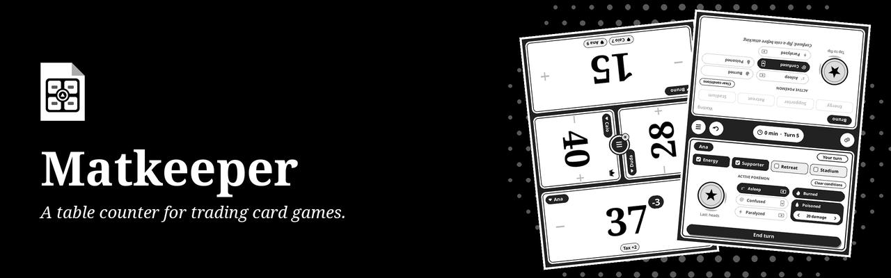
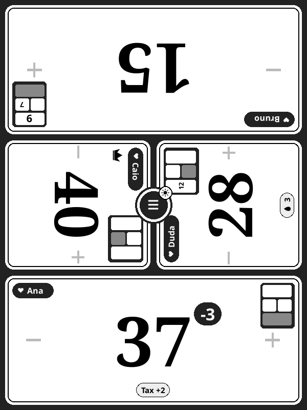
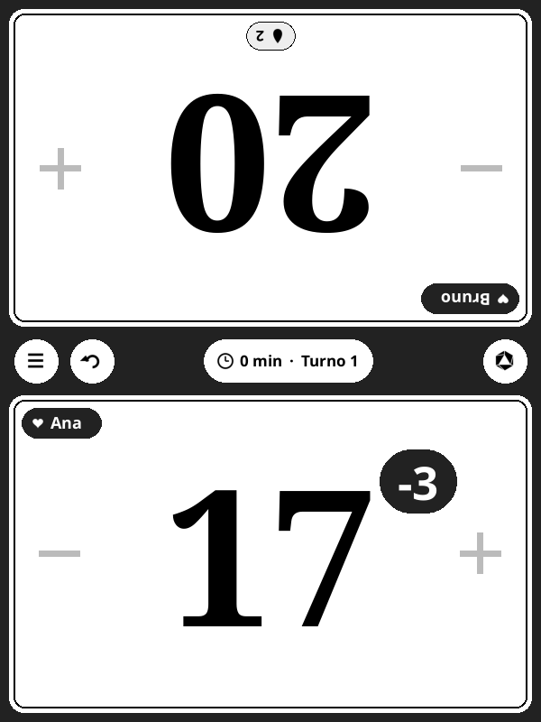
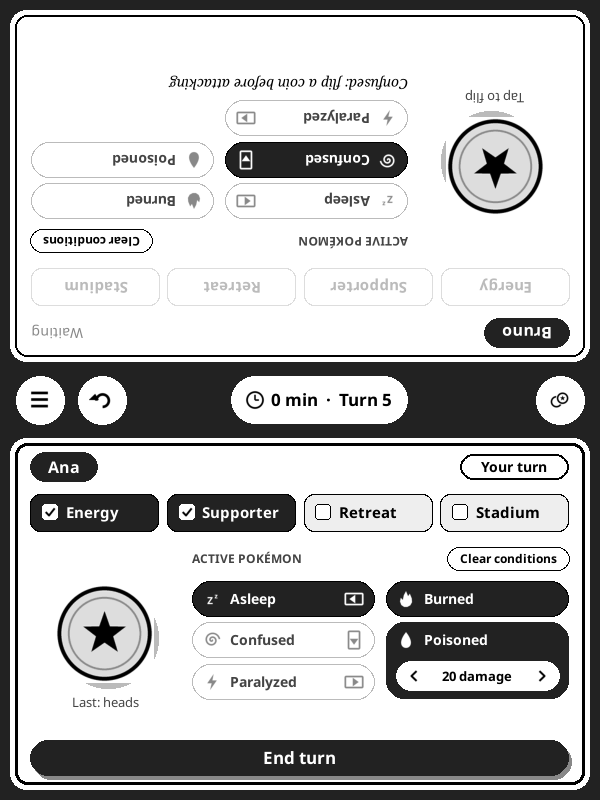
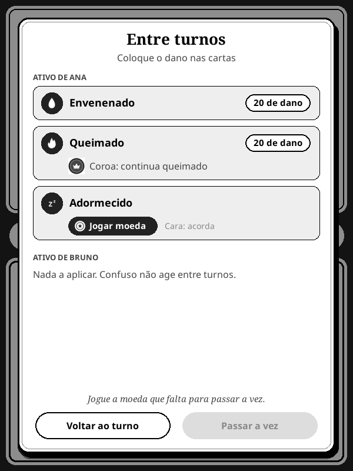
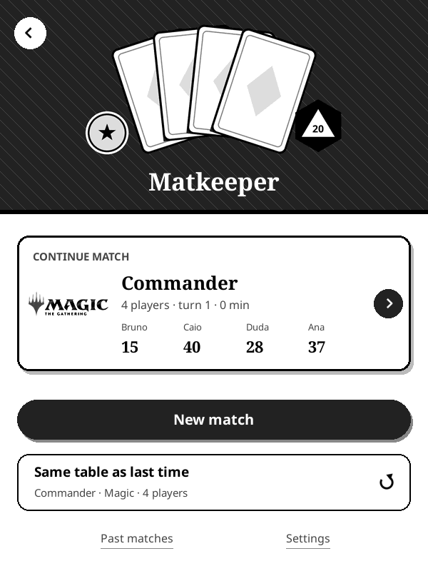
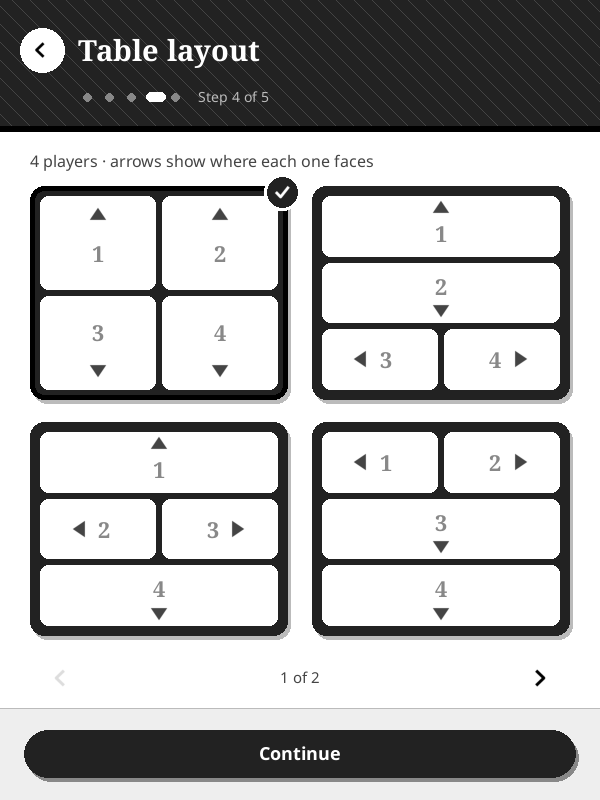
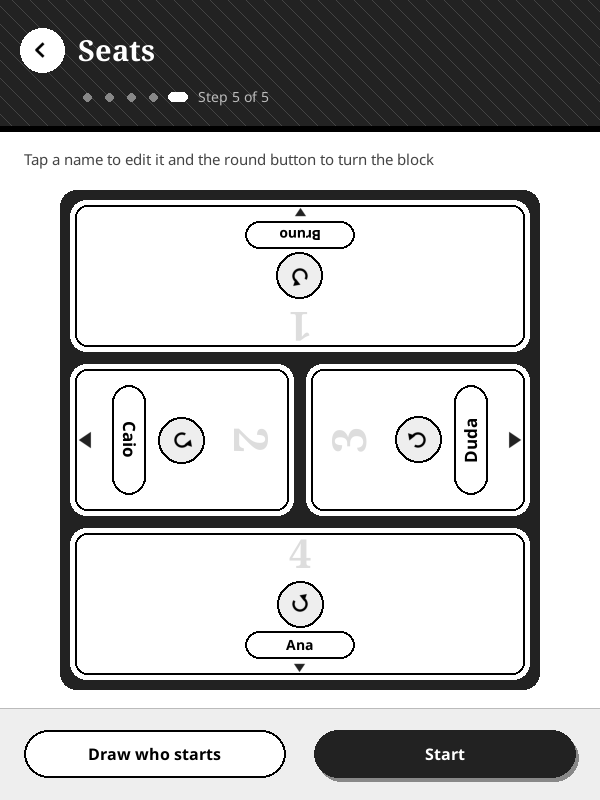
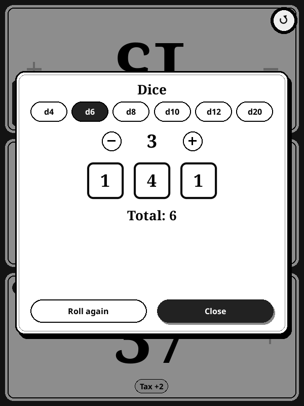

<p align="center">
  
</p>

<p align="center">
  <strong>A table counter for trading card games in KOReader, made for e-ink. In Portuguese, English and Spanish.</strong>
</p>

<p align="center">
  <a href="https://github.com/beater-studios/matkeeper.koplugin/releases/latest"></a>
  <a href="https://github.com/beater-studios/matkeeper.koplugin/actions/workflows/ci.yml"></a>
  <a href="https://koreader.rocks"></a>
  
  <a href="LICENSE"></a>
</p>

<p align="center">
  <a href="#what-it-does">What it does</a> ·
  <a href="#installation">Installation</a> ·
  <a href="#how-to-use">How to use</a> ·
  <a href="#development">Development</a> ·
  <a href="README_pt.md">Leia em português</a>
</p>

## What it does

<table>
  <tr>
    <td width="25%" align="center"><br><sub><b>Commander for four</b></sub></td>
    <td width="25%" align="center"><br><sub><b>Face to face</b></sub></td>
    <td width="25%" align="center"><br><sub><b>Pokémon turn panel</b></sub></td>
    <td width="25%" align="center"><br><sub><b>Between turns</b></sub></td>
  </tr>
  <tr>
    <td width="25%" align="center"><br><sub><b>Home</b></sub></td>
    <td width="25%" align="center"><br><sub><b>Table layouts</b></sub></td>
    <td width="25%" align="center"><br><sub><b>Seats</b></sub></td>
    <td width="25%" align="center"><br><sub><b>Dice</b></sub></td>
  </tr>
</table>

The e-reader lies on the table for hours with battery to spare, does not reflect light and never buzzes. This plugin turns it into the table: pick the game and the format, choose how many players and how the table is laid out, and every block turns to face its player.

- **Magic: The Gathering:** Standard (20), Commander (40), Two-Headed Giant (30 per team) and Brawl (25 for two, 30 for more), plus Custom: 2 to 6 players, the starting life you want, and poison, commander damage and commander tax on or off. Poison, energy, experience and rad counters; commander damage from each opponent, shown on a small map of the table where each one sits, with partners counted apart; commander tax; the monarch, the initiative, and day or night.
- **Pokémon TCG as a turn panel:** damage, prizes and the Bench stay on the table, with dice and markers. The plugin keeps what is easy to forget: the once-per-turn reminders (Energy, Supporter, Retreat, Stadium), a coin for each player, the Special Conditions of each Active Pokémon (Asleep, Confused and Paralyzed replace each other), poison stronger than 10, and the Checkup between turns, which says how much damage to put on the cards and flips the coins each condition asks for.
- **Your own table:** from 2 to 6 players, a choice of layouts for each count, and a turn button on every block. The layouts come from a rule (bands of one or two blocks), so every count has a few sensible shapes.
- **Dice and coins:** d4 to d20, several at once with the total, several coins, "until tails", and who starts: a d20 for everyone in Magic, a called coin in Pokémon.
- **A clock in minutes:** the match time, a round countdown and the turn count, updated once a minute to spare the battery.
- **Undo, a log and past matches:** every change can be undone, the match is saved after each one, and finished matches keep their log to read later.
- **Made for e-ink:** big numbers, taps on halves of the block (left takes, right gives, a hold moves 10), a few taps between changes before they are logged, and only the block that changed is redrawn.
- **Awake on the table:** the device stays awake while the table is open, and the power button still puts it to sleep. A table left 30 minutes without a touch lets the device sleep again. Asleep with the plugin open, the sleep screen shows the Matkeeper cover instead of the book cover.
- **Three languages:** Portuguese, English and Spanish. No internet and no data collected.

## Installation

1. Download `matkeeper.koplugin.zip` from the [latest release](https://github.com/beater-studios/matkeeper.koplugin/releases/latest).
2. Unzip it into the `plugins` folder of KOReader, so you get `koreader/plugins/matkeeper.koplugin/`.
3. Restart KOReader. The plugin is in **Tools > Matkeeper**.

The checksum of each release is in `matkeeper.koplugin.zip.sha256`. The current match and your preferences live in `koreader/settings/matkeeper.lua`, and past matches in `koreader/settings/matkeeper_history.lua`. To uninstall, delete the plugin folder and these two files.

## How to use

1. **New match:** pick the game, the format, the number of players and the layout. On the last step, tap a name to change it and the round button at the center of a block to turn it towards its player (it stays in place, so keep tapping until the block faces the right side). A custom Magic match asks for its rules first. "Draw who starts" rolls or flips before the match begins.
2. **Life (Magic):** tap the right half of a block to gain 1, the left half to lose 1, or hold for 10. The change shows next to the number and goes into the log after two seconds. Tap the number to type a value. Tap the counters at the bottom to change them, and the name for the player's menu (rename, counters, concede). These dialogs face the player; the round button at the top right corner of the screen turns them towards whoever is using them.
3. **Commander damage:** the small map in the corner of a block is the table as that player sees it, with the damage each opponent's commander dealt in their seat. Tap it to open the large map, where the left half of an opponent takes 1 and the right half gives 1 (hold for 5). Damage from a commander also comes off life.
4. **Turn (Pokémon):** mark the reminders as you go, tap the coin to flip it, and mark the conditions of the Active Pokémon. Retreating clears them; "Clear conditions" covers evolving, a Knock Out or a switch. "End turn" opens the Checkup when there is something to apply.
5. **The table menu** (the round button, the bar or the controls cell): undo, dice, coins, the clock, the monarch and friends, the log, ending the match or leaving the table. Leaving keeps the match for later, with the clock paused. Starting a new match puts the unfinished one in past matches.
6. **The end:** a defeat with three or more players left puts that player out and the match goes on; with two, the plugin offers to end it with the other player as the winner, or to keep playing (some cards change these rules). "End match" lets you mark the winner, a draw or no winner.

## Compatibility

- Made for KOReader 2026.07 and for touchscreens, always in portrait: the blocks turn inside the screen to face each player. It was developed for a 10th generation basic Kindle (firmware 5.18.1).
- Layout checked in the emulator at 600x800, 758x1024, 1072x1448 and 1264x1680.
- Uses only what comes with KOReader, with nothing else to install.

## Development

With [LuaJIT](https://luajit.org) installed, from the repository root, the same checks as the CI:

```sh
sh tools/check.sh   # tests, texts and the package
```

With the official KOReader for desktop, `KOREADER_DIR` pointing at the folder with `luajit` and `reader.lua`:

```sh
tools/koreader/run_emulator.sh                                    # opens KOReader with the plugin, 600 x 800
tools/koreader/check_all_sizes.sh                                 # every screen in four screen sizes
tools/koreader/run_headless.sh tools/koreader/fuzz_ui.lua         # random touches on every layout
OUTPUT_DIR=shots tools/koreader/run_headless.sh tools/koreader/render_screens.lua
```

The other checks (`check_screensaver.lua`, `check_rotation.lua`, `check_awake.lua`, `check_sleep.lua`) run the same way and are listed in [docs/design.md](docs/design.md).

The images in `assets/` come from `tools/make_assets.py`, the README screenshots from `tools/koreader/readme_screens.sh` and the banner, the icon and the social preview from `tools/make_brand_art.py` (Pillow). How the code is organized and why is in [docs/design.md](docs/design.md). Contributions are accepted under the project's license.

## License

The code is under [GPL-3.0](LICENSE), version 3 only. You may use, study, modify and redistribute it, keeping it open under the same license. This license grants no rights to the names "Matkeeper" and "Beater Studios". See [NOTICE](NOTICE).

Magic: The Gathering is a trademark of Wizards of the Coast; Pokémon is a trademark of Nintendo, Creatures and GAME FREAK. Their logos only identify each game. This plugin is unofficial and not affiliated with them.

---

<p align="center">
  <sub>Made by <a href="https://beaterstudios.com/">Beater Studios</a></sub>
</p>
