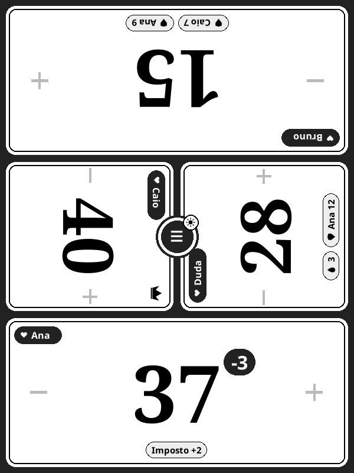
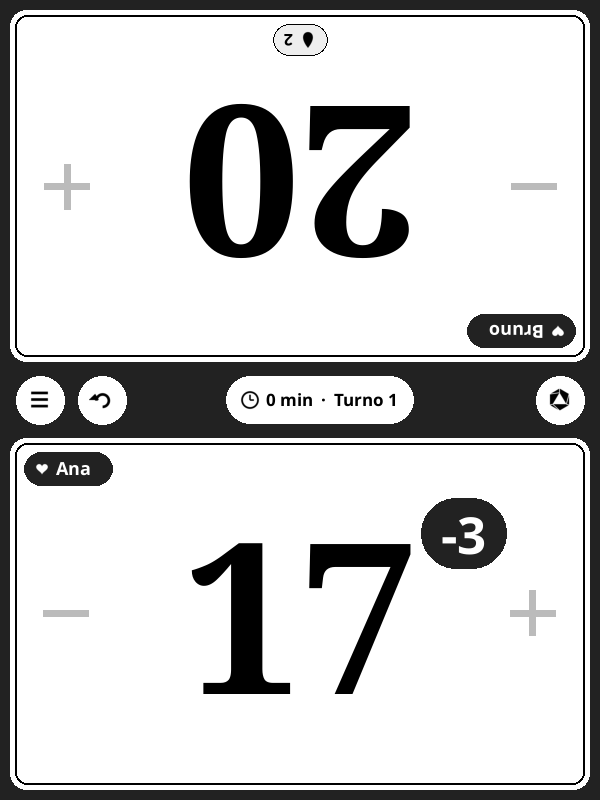
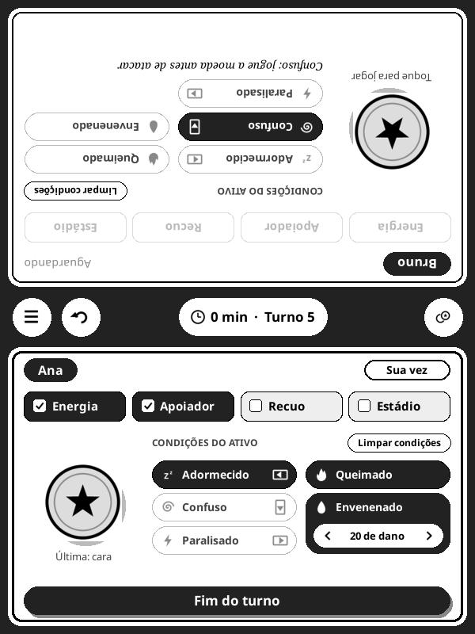
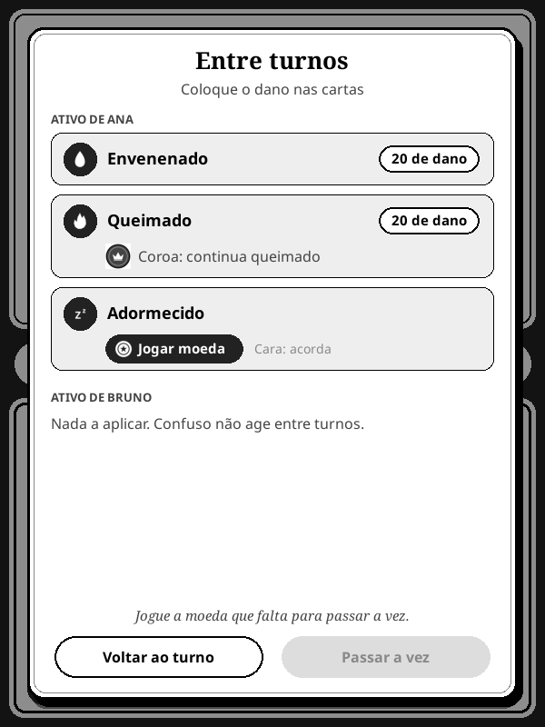

  <strong>Um contador de mesa para jogos de cartas colecionáveis no KOReader, feito para e-ink. Em português, inglês e espanhol.</strong>

  <a href="#o-que-faz">O que faz</a> ·
  <a href="#instalação">Instalação</a> ·
  <a href="#como-usar">Como usar</a> ·
  <a href="README.md">Read in English</a>

## O que faz

<table>
  <tr>
    <td width="25%" align="center"> <b>Commander para quatro</b></td>
    <td width="25%" align="center"> <b>Frente a frente</b></td>
    <td width="25%" align="center"> <b>Painel do turno</b></td>
    <td width="25%" align="center"> <b>Entre turnos</b></td>
  </tr>
</table>

O leitor fica deitado na mesa por horas com bateria sobrando, não reflete a luz e não vibra. Este plugin transforma o aparelho na mesa: escolha o jogo e o formato, quantos jogadores e como a mesa fica, e cada bloco se vira para o seu jogador.

- **Magic: The Gathering:** Padrão (20), Commander (40), Two-Headed Giant (30 por dupla) e Brawl (25 para dois, 30 para mais), além do Personalizado: de 2 a 6 jogadores, a vida inicial que quiser e veneno, dano de comandante e imposto de comandante ligados ou desligados. Veneno, energia, experiência e radiação; dano de comandante de cada adversário, com parceiros separados; imposto do comandante; monarca, iniciativa e dia ou noite.
- **Pokémon TCG como painel do turno:** dano, prêmios e banco ficam na mesa, com dados e marcadores. O plugin cuida do que se esquece: os lembretes de uma vez por turno (Energia, Apoiador, Recuo, Estádio), uma moeda por jogador, as condições especiais de cada ativo (Adormecido, Confuso e Paralisado se substituem), veneno mais forte que 10 e o intervalo entre turnos, que diz quanto dano colocar nas cartas e joga as moedas de cada condição.
- **A sua mesa:** de 2 a 6 jogadores, alguns layouts para cada quantidade e um botão de girar em cada bloco.
- **Dados e moedas:** d4 a d20, vários de uma vez com a soma, várias moedas, "até sair coroa" e quem começa: um d20 para todos no Magic, cara ou coroa no Pokémon.
- **Relógio em minutos:** tempo da partida, tempo de rodada e contador de turnos, atualizados uma vez por minuto para poupar a bateria.
- **Desfazer, registro e partidas anteriores:** toda mudança pode ser desfeita, a partida é salva a cada uma, e as partidas terminadas guardam o registro para ler depois.
- **Feito para e-ink:** números grandes, toques nas metades do bloco (esquerda tira, direita soma, segurar muda 10) e só o bloco que mudou é redesenhado.
- **Três idiomas:** português, inglês e espanhol. Sem internet e sem coleta de dados.

## Instalação

1. Baixe `matkeeper.koplugin.zip` da [última versão](https://github.com/beater-studios/matkeeper.koplugin/releases/latest).
2. Descompacte na pasta `plugins` do KOReader, para ficar `koreader/plugins/matkeeper.koplugin/`.
3. Reinicie o KOReader. O plugin fica em **Ferramentas > Matkeeper**.

A partida atual e as preferências ficam em `koreader/settings/matkeeper.lua`, e as partidas anteriores em `koreader/settings/matkeeper_history.lua`.

## Como usar

1. **Nova partida:** escolha o jogo, o formato, quantos jogadores e o layout. No último passo, toque no nome para mudar e no botão redondo no centro de um bloco para girá-lo (ele não sai do lugar, então é só tocar de novo até o bloco ficar virado para o lado certo). Uma partida personalizada de Magic pergunta as regras antes. "Sortear quem começa" rola ou joga a moeda antes de começar.
2. **Vida (Magic):** toque na metade direita do bloco para somar 1, na esquerda para tirar 1, ou segure para 10. A mudança aparece ao lado do número e entra no registro depois de dois segundos. Toque no número para digitar um valor, nos marcadores embaixo para mudá-los, e no nome para o menu do jogador (nome, marcadores, desistir).
3. **Turno (Pokémon):** marque os lembretes, toque na moeda para jogar e marque as condições do ativo. Recuar limpa as condições; "Limpar condições" serve para evolução, nocaute ou troca. "Fim do turno" abre o intervalo entre turnos quando há algo a aplicar.
4. **Menu da mesa** (o botão redondo, a barra ou a célula de controles): desfazer, dados, moedas, relógio, monarca e companhia, registro, encerrar a partida ou sair da mesa. Sair guarda a partida para depois, com o relógio pausado. Começar uma partida nova põe a que não terminou nas partidas anteriores.
5. **O fim:** uma derrota com três ou mais jogadores restantes deixa o jogador fora do jogo e a partida segue; com dois, o plugin oferece encerrar com o outro como vencedor ou continuar (há cartas que mudam essas regras). "Encerrar partida" marca o vencedor, um empate ou nenhum.

Desenvolvimento, licença e marcas estão no [README em inglês](README.md).
